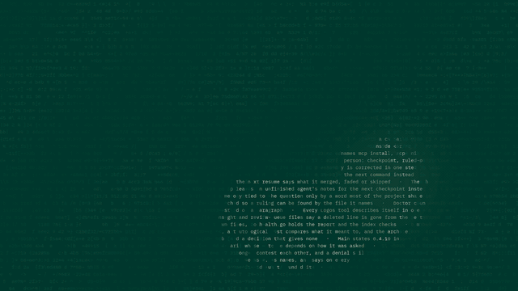

<div align="center">

# Logos

**When one coding agent stops, the next one continues the work.**

[](https://github.com/Coder8124/logos/actions/workflows/ci.yml)
[](https://github.com/Coder8124/logos/releases)
[](https://www.npmjs.com/package/@noeton/logos)
[](https://github.com/Coder8124/homebrew-tap)
[](LICENSE)

[](go.mod)
[](https://pkg.go.dev/github.com/Coder8124/logos)
[](https://github.com/Coder8124/logos/wiki/Installation)
[](https://github.com/Coder8124/logos/wiki/MCP-Tools-Reference)
[](https://github.com/Coder8124/logos/wiki/Settings-and-Privacy)
[](https://github.com/Coder8124/logos/stargazers)
[](https://github.com/Coder8124/logos/discussions)

[Docs](https://github.com/Coder8124/logos/wiki) · [Quick Start](https://github.com/Coder8124/logos/wiki/Quick-Start) · [Benchmark](docs/continuity-benchmark.md) · [Site](https://coder8124.github.io/logos/) · [Issues](https://github.com/Coder8124/logos/issues)



</div>

Logos is a local-first memory and continuity layer for coding agents. Claude
Code, Codex, Cursor and your own agents share one vault over MCP. An agent
checkpoints what it did, and the next one resumes where it stopped, even if it
is a different model, in a different tool, on a different day.

```
Claude Code  ──▶  checkpoint  ──▶  Logos  ──▶  resume  ──▶  Cursor
                                (your vault)
```

The vault is a folder of markdown files on your machine. Nothing is uploaded,
and the SQLite index beside it is a cache: delete it, run `logos index`, and you
lose nothing.

## Quick start

```sh
brew install coder8124/tap/logos-mcp && logos setup    # macOS and Linux
npm i -g @noeton/logos && logos setup                  # Windows
```

`setup` picks a vault, shows which agents it would wire, and asks before
touching any of them (`--dry-run` writes nothing). For Claude Code it also
installs the plugin, so the last handoff is in front of the model before it does
anything.

The formula is `logos-mcp`: a bare `brew install logos` installs Logos Bible
Software. Building from source, hand-wiring a host and the one-click buttons are
in **[Installation](https://github.com/Coder8124/logos/wiki/Installation)**.

## What it does

- **Resume where the last agent stopped.** `resume` shows what was done, what
  was verified and what is still open.
- **Stop the next agent repeating a dead end.** Ruled-out approaches are their
  own field, and `before_you_try` checks a plan against them.
- **Keep "verified" apart from "claimed".** Resume marks another agent's
  verified items as its claim, and flags a command the activity log never saw.
- **Answer "why is this code like this?"** `why <path>` shows what was being
  decided when a file was last worked on.
- **Remember what lasts.** Decisions, constraints and procedures, reviewed
  before they become project memory.
- **Bring your history.** Import CLAUDE.md, AGENTS.md, Cursor rules, claude-mem,
  Claude Code's auto memory, transcripts or git history.

Every write returns a receipt, so you can see it working.
[The Handoff Loop](https://github.com/Coder8124/logos/wiki/The-Handoff-Loop)
shows how an agent uses it, step by step.

## Works with

Claude Code, Codex, Cursor, Claude Desktop, Cline, Devin, GitHub Copilot,
opencode, Amp, Grok Build, and anything else that speaks MCP. Agents with only a
shell get a CLI command for every tool. See
[Agent Hosts](https://github.com/Coder8124/logos/wiki/Agent-Hosts).

## Does it work?

On a handoff suite built for this (32 scenarios, nine memory systems, one
machine), Logos passes **84.4%**. The next best system passes 46.9%.

Every real system retrieves about equally well. What separates them is whether
the agent that resumes gets the *current* answer, or gets it next to the stale
one it replaced. Method, per-scenario scores and the cases Logos loses are in
[the benchmark](docs/continuity-benchmark.md).

## Local, private and durable

- **No model required.** Search falls back from local embeddings (Ollama) to
  full-text search, and nothing breaks.
- **Nothing is observed.** Logos does not watch your screen, browser or files.
  The vault holds what agents wrote there, plus the Claude Code plugin's
  activity log, which you can turn off.
- **Nothing leaves.** `logos doctor --egress` lists every address Logos can
  contact, and when.
- **Hard to break.** It survives SIGKILL mid-write, a full disk, sync-client
  conflict copies and two worktrees racing on one vault ([`chaos/`](chaos/)).

Exactly what is recorded, and every switch for it, is in
[Settings and Privacy](https://github.com/Coder8124/logos/wiki/Settings-and-Privacy).

## Documentation

Everything lives in the **[wiki](https://github.com/Coder8124/logos/wiki)**.

| Start | Use | Look up |
| --- | --- | --- |
| [Installation](https://github.com/Coder8124/logos/wiki/Installation) | [The Handoff Loop](https://github.com/Coder8124/logos/wiki/The-Handoff-Loop) | [CLI Reference](https://github.com/Coder8124/logos/wiki/CLI-Reference) |
| [Quick Start](https://github.com/Coder8124/logos/wiki/Quick-Start) | [Memory](https://github.com/Coder8124/logos/wiki/Memory) | [MCP Tools Reference](https://github.com/Coder8124/logos/wiki/MCP-Tools-Reference) |
| [Core Concepts](https://github.com/Coder8124/logos/wiki/Core-Concepts) | [Importing History](https://github.com/Coder8124/logos/wiki/Importing-History) | [Agent Hosts](https://github.com/Coder8124/logos/wiki/Agent-Hosts) |
| [Troubleshooting](https://github.com/Coder8124/logos/wiki/Troubleshooting) | [The Vault](https://github.com/Coder8124/logos/wiki/The-Vault) | [Embedding in Go](https://github.com/Coder8124/logos/wiki/Embedding-in-Go) |

## Contributing

Contributions are welcome. [CONTRIBUTING.md](CONTRIBUTING.md) covers the build,
the test tiers and the two load-bearing conventions: the vault is the truth, and
every feature announces itself. Agents working here get the `context-connect`
and `continuity` skills from the plugin (`plugin/skills/`); this repository
dogfoods its own plugin.

**Coming from `brain`?** Since 0.5.0 the old names are not read. `logos migrate`
moves a `~/brain` vault; see
[Moving a 0.4 vault](SETUP.md#moving-a-04-vault).

## License

Apache 2.0. See [LICENSE](LICENSE). Git history satisfies §4(b), so there are no
change notices to add and no CLA
([details](CONTRIBUTING.md#licensing-and-what-you-do-not-have-to-do)).
Prior work that shaped the ideas is in [systemmd/CREDITS.md](systemmd/CREDITS.md).
